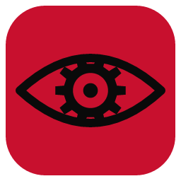
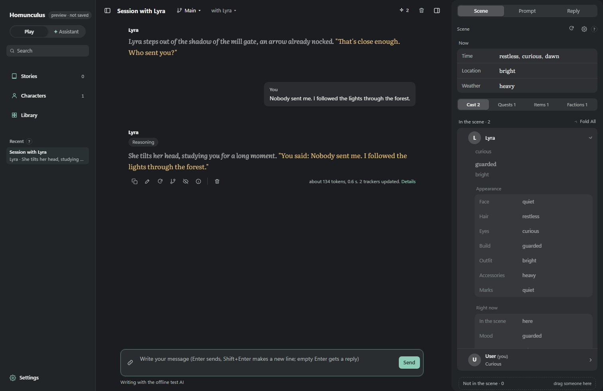

<div align="center">



# Homunculus 2

**A desktop app for roleplay with AI — 1:1 chats and narrated stories, with trackers that remember the scene for you.**

[](https://github.com/VasahTS/Project-Homunculus/releases/latest)
[](https://github.com/VasahTS/Project-Homunculus/releases/latest)

[](https://github.com/VasahTS/Project-Homunculus/releases/latest)
[](https://github.com/VasahTS/Project-Homunculus/actions/workflows/ci.yml)
[](LICENSE)

**Testing Homunculus?** Read the [tester's guide](docs/TESTING.md): installing, updating and reporting problems.

</div>

<p align="center"></p>

## What it does

- **Chats and stories.** Talk 1:1 with a character, or start a **Story** told by a narrator, with NPCs, a scenario and openings. Save a setup as a **Kit** and start new stories from it.
- **Trackers.** After each reply, a separate AI call keeps the **Scene** up to date — who is here, where, when, moods, goals — and you see exactly what changed.
- **SillyTavern at the border.** Import and export character cards (PNG/JSON), lorebooks (World Info, same activation rules), personas and Chat Completion presets. Export chats as SillyTavern JSONL, Markdown or text.
- **Nothing lost in silence.** Branches, swipes, character versions, an Author's Note, a Trash with undo, and the exact prompt sent for every reply.
- **Your data stays on your computer.** A local SQLite database with automatic backups before upgrades; API keys in the system keychain (Windows Credential Manager, GNOME Keyring / KWallet on Linux).
- **Any OpenAI-compatible service.** OpenRouter, OpenAI, or a local server.
- **Windows and Linux.** A Windows installer, a Linux AppImage and a Debian/Ubuntu `.deb`.
- **Updates itself.** When a new version is out, a quiet bar offers **Update & Restart**. Nothing installs until you click.

## Install

Open the [latest release](https://github.com/VasahTS/Project-Homunculus/releases/latest) and download the file for your system:

| System | File | How |
|---|---|---|
| Windows | `Homunculus_…_x64-setup.exe` | Run it. Windows may say *"Windows protected your PC"* because the app is not code-signed: **More info → Run anyway**. |
| Linux (any) | `Homunculus_…_amd64.AppImage` | `chmod +x Homunculus_*.AppImage`, then run it. Updates itself. |
| Debian / Ubuntu | `Homunculus_…_amd64.deb` | `sudo apt install ./Homunculus_…_amd64.deb`. New versions install the same way; the app tells you when one is out. |

Then open **Settings → Connections**, add your service and key, and start a chat from **Characters**.

Updating: the app tells you. Your chats, characters and keys are kept.

## Build from source

Needs [Node.js 24 LTS](https://nodejs.org) (the version in `.nvmrc`, also used by CI and release builds) and [Rust](https://rustup.rs) (for the desktop shell). On Debian/Ubuntu also: `sudo apt install libwebkit2gtk-4.1-dev libayatana-appindicator3-dev librsvg2-dev libdbus-1-dev libssl-dev libxdo-dev`.

```bash
npm install
npm run app          # run the desktop app from the code
npm test             # unit tests
npm run test:all     # typecheck + unit tests + click tests (run `npx playwright install chromium` once)
npm run app:build    # Windows installer
```

On Windows you can also double-click **`Open Homunculus.bat`**.

## Branches and releases

- **`dev`** — day-to-day work. Every push runs the tests.
- **`main`** — what testers get. Merge `dev` into `main` when it is ready to ship.

To release: **Actions → Publish release → Run workflow** on `main`, and type the new version (e.g. `0.2.0`). The workflow runs the tests, builds and signs the Windows installer and the Linux `.deb` and AppImage, publishes the release with `latest.json` for the in-app updater, and merges the new version number back into `dev`. Step by step: [`docs/RELEASING.md`](docs/RELEASING.md).

## Project docs

| | |
|---|---|
| [`docs/ARCHITECTURE.md`](docs/ARCHITECTURE.md) | How the core works |
| [`docs/DECISIONS.md`](docs/DECISIONS.md) | Every design decision, numbered (D-001…) |
| [`docs/BLUEPRINT.md`](docs/BLUEPRINT.md) | The whole app on one map |
| [`docs/reference/`](docs/reference/README.md) | Where things live in SillyTavern, Homunculus v1, Marinara and Aventuras |
| [`HANDOFF.md`](HANDOFF.md) | Handoff notes between work sessions |
| [`CHANGELOG.md`](CHANGELOG.md) | What changed in each version |

## License and credits

[AGPL-3.0-only](LICENSE). Code adapted from other projects is listed in [`CREDITS.md`](CREDITS.md) with its original notices.
