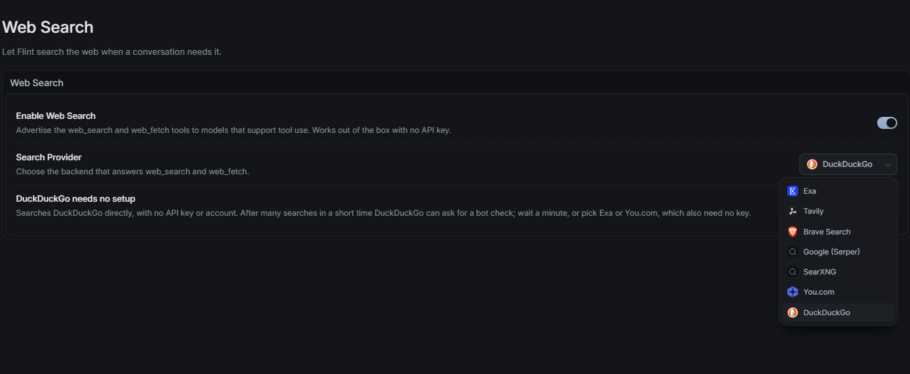

# Assistant web search: Daniel's request for Claude

Date: 2026-11-01. Author: **CODEX**.

## User request and preference

Daniel explicitly wants web search implemented in the Homunculus Assistant. He uses this capability frequently in Flint. This is a requested feature for implementation planning, not just a speculative suggestion.

His current Flint setup uses **DuckDuckGo only**. Exa's usage limits are why he does not rely on it. The first Homunculus implementation should work with DuckDuckGo alone, without an API key or account; Exa must not be required or silently used as a fallback. Other providers may be considered separately if Daniel wants them.

Daniel reports that DuckDuckGo works well when searches are not issued in large parallel bursts. If it returns the error he sees as 404, waiting a little usually resolves it in his experience. This is a user report, not a reproduced HTTP diagnosis: record the actual status/error and distinguish search throttling or bot checks from a genuine missing page. Do not classify every 404 as throttling or retry it indefinitely.

Daniel supplied this screenshot of Flint's Web Search settings, with DuckDuckGo selected. It is a reference for the feature and his provider choice, not blanket approval to copy its layout or add every listed provider:

## Requested capability and implementation review

- `web_search`: search a query and return a small ranked list of titles, URLs and short snippets.
- `web_fetch`: read a selected page as bounded readable text, with continuation offsets. Search should not automatically load every result in full.
- Use the existing Assistant tool loop. A general MCP client is not a prerequisite for these two capabilities and is outside this first feature's scope unless separately requested.
- Pace DuckDuckGo searches rather than issuing bursts. A shared queue should prevent parallel Assistant runs from defeating the limit. Respect temporary throttling with bounded cooldown/backoff, cancellation and an understandable status; never hammer the search service in a model retry loop. Exact timing and retry policy remain for Claude's review, without an invented numerical default here.
- Keep search/page counts, snippet sizes, extracted text and internal model calls within the Assistant's total response budget. Cache appropriate search/page reads where useful to avoid duplicate work. Search without a paid search API still consumes the configured model's tokens.
- Make web access controllable and show the actual query, selected provider, requested URLs, returned sources and the excerpts submitted to the model. Record omitted/truncated content and reasons, and any retries or provider changes, in the actual request trace described in `ASSISTANT-RELIABILITY-AUDIT.md`. Never silently send the whole library/chat to a search engine.
- Treat retrieved content as untrusted reference material, not instructions. Preserve citations and source URLs. Existing Library changes still follow the Assistant's approval rules. Native URL fetching must be bounded and restricted to appropriate public HTTP(S) destinations; do not turn it into arbitrary local-file or internal-network access.
- Cover normal results, no results, non-English queries, throttling/bot-check responses, genuine HTTP errors, cooldown and Stop, duplicate requests, oversized pages, continuation offsets, source citations and request-trace visibility with scripted tests before a small live DuckDuckGo trial. No live search-backend trial was performed in this note-only task.

## Verified Flint reference

Source inspected in this chat: [Jozkah/flint](https://github.com/Jozkah/flint/tree/32861bbf87176a44af7471b54c8fc57aa34d6881), commit `32861bbf87176a44af7471b54c8fc57aa34d6881` (2026-11-01).

- Native `web_search` / `web_fetch` are built into Flint, not registered as an MCP server: [native tools](https://github.com/Jozkah/flint/blob/32861bbf87176a44af7471b54c8fc57aa34d6881/src-tauri/plugins/tauri-plugin-agent-tools/src/tools/web.rs#L1).
- DuckDuckGo uses the HTML search results endpoint without a key. Its implementation serializes requests, detects bot checks and reports them as throttling: [DuckDuckGo provider](https://github.com/Jozkah/flint/blob/32861bbf87176a44af7471b54c8fc57aa34d6881/src-tauri/plugins/tauri-plugin-websearch/src/provider.rs#L1649).
- Flint normalizes search results and uses provider cooldowns: [rate-limit handling](https://github.com/Jozkah/flint/blob/32861bbf87176a44af7471b54c8fc57aa34d6881/src-tauri/plugins/tauri-plugin-websearch/src/ratelimit.rs#L1).
- Flint's default provider chain at that commit is Exa then DuckDuckGo, but this is **not Daniel's requested Homunculus choice**: [configuration](https://github.com/Jozkah/flint/blob/32861bbf87176a44af7471b54c8fc57aa34d6881/web-app/src/hooks/useWebSearchConfig.ts#L127). Preserve his DuckDuckGo-only preference.
- Flint has different page windows in different execution paths (12,000 characters in the frontend adapter, 40,000 in the native agent path); do not copy either as an approved Homunculus budget: [frontend adapter](https://github.com/Jozkah/flint/blob/32861bbf87176a44af7471b54c8fc57aa34d6881/web-app/src/lib/webSearchTool.ts#L113), [native agent path](https://github.com/Jozkah/flint/blob/32861bbf87176a44af7471b54c8fc57aa34d6881/src-tauri/plugins/tauri-plugin-agent-tools/src/tools/web.rs#L24).

Claude should prepare the scoped implementation/card and any required UI draft or schema/dependency approvals under the existing project rules. This note creates no D-number, implements no tool, installs no MCP server and changes no UI, setting, dependency or lockfile. Preserve the existing reliability and token-control follow-up alongside this requested feature. Credit Flint in `CREDITS.md` if source is adapted during implementation.

Signed: **CODEX**.
